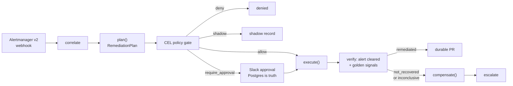

# HealOps — Full Implementation Plan

## Verified starting state

The repo contains **no implementation**. Git tracks 17 files, all documentation:

- [HealOps_Implementation_Plan_Rev2.md](HealOps_Implementation_Plan_Rev2.md) — 3,632-line spec
- Seven `*.SKILL.md` files at the root plus [healops-python-engine.references-data-model-and-endpoints.md](healops-python-engine.references-data-model-and-endpoints.md)
- `.claude/skills/*.skill` — ZIP archives, each containing `<name>/SKILL.md` byte-identical to the matching root markdown. Neither Cursor nor Claude Code loads them in this form.

No `engine/`, `dashboard/`, `charts/`, `chaos-app/`, `policy/`, `evals/`, `k8s/`, `monitoring/`, or `.github/`.

**Local toolchain already matches the mandated pins:** Python 3.14.6, Node 24.12 LTS, Helm v4.2.4, kubectl v1.36.1, kind 0.32.0, uv 0.11.6, gh 2.92.0, Docker 29.7.2. Only gap: the Docker daemon is stopped, so Docker Desktop must be started before Phase 1.

## Correction that applies throughout

Sections §9.1 and §10 of the Rev 2 document still contain **Rev 1 code blocks with stale pins** — `version: '3.8'`, Python 3.12, Node 20, `minio/minio:latest`, `grafana/grafana:latest`, `image.tag: latest`, and `redis-server`/`redis-cli` commands against a `valkey/valkey:9-alpine` image. The `healops-kubernetes-platform` skill explicitly flags all of these. **The skills supersede those code blocks.** Everything gets pinned; Valkey uses `valkey-server`/`valkey-cli`.

## The pipeline being built

Every branch, including the two that do nothing, appends to the hash-chained ledger.

## Invariants enforced in every phase

- Success means the incident is over, never that an API call returned 200.
- A runbook that cannot describe its own undo is not registered — `compensate()` is abstract.
- Compensation is persisted **before** the action runs.
- Refusals and denials are audited outcomes, not errors.
- Auto-vs-approval is computed by policy from plan properties, never hardcoded per runbook.
- A missing signal is never a healthy signal — unavailable metrics produce `inconclusive`.
- The ledger append happens in the same transaction as the state change. No ledger write means no action.
- `can_execute()` fails closed.

---

## Phase 0 — Skills as global rules, plus repo scaffold

**Rules wiring (full mirror, as chosen):**

- Unpack each `.claude/skills/*.skill` zip into the layout Claude Code actually reads: `.claude/skills/healops-python-engine/SKILL.md`, `.../references/data-model-and-endpoints.md`, and the same for the other six. Remove the `.skill` archives once unpacked.
- Create `.cursor/rules/` with one always-apply core rule (`healops-core.mdc`) carrying the version pin matrix, the seven invariants above, and the pipeline order; plus glob-scoped rules that pull in the matching skill: `engine/**` → python-engine, `engine/src/runbooks/**` and `policy/**` → remediation-safety, `dashboard/**` → nextjs-dashboard, `charts/**` `k8s/**` `.github/**` → kubernetes-platform, `engine/src/ledger.py` `cli/**` → audit-ledger, `engine/src/gitops.py` → gitops-remediation, `evals/**` `engine/src/promotion.py` → mlops-promotion.
- Root `AGENTS.md` stating the mandates inline and pointing at both trees.

**Scaffold:** the §5.1 directory tree, `pyproject.toml` with `requires-python = ">=3.14"` managed by `uv`, pinned `docker-compose.yml` (postgres 18.6-alpine, valkey 9-alpine with `valkey-server`, pinned MinIO, `grafana/grafana:13.0.x`, no `version:` key), `Makefile`, `k8s/kind/cluster.yaml` on `kindest/node:v1.36.x`, `.gitignore`, `.env.example`.

## Phase 1 — Cluster, alerts, chaos app (Week 1)

- kind 1.36 cluster; `kube-prometheus-stack` at an explicit chart version (~88.x), Alertmanager 0.33.1 in 3-replica HA gossip mode.
- `charts/alerting-rules/templates/prometheusrule.yaml` — five rules: `KubePodCrashLooping`, `NodeDiskPressure`, `HighPodCPU`, `KubePodOOMKilled`, `KubeNodeNotReady`. Use the dimensionless throttle ratio and `container_oom_events_total`, never raw counters or `last_terminated_reason`.
- `k8s/prometheus/alertmanager-config.yaml` — webhook to `http://healops-engine:8000/api/webhooks/alertmanager` with shared secret, UTF-8 strict mode, and `inhibit_rules` as the first line of storm defence.
- `chaos-app/` — `crashy-api`, `hungry-worker`, `cpu-burner`, `log-spammer`, plus the `flaky-node` taint injector. **Build the corpus-capture path now** (alert payload + cluster state as JSON bundles); retrofitting it later is tedious.

**Proves it:** five alerts firing, webhook receiver logging v2 payloads.

## Phase 2 — Engine core, correlation, schema, ledger (Week 2)

- FastAPI receiver in [engine/src/api/webhooks.py](engine/src/api/webhooks.py): constant-time secret compare, persist to Postgres, `XADD`, return **202**. Durable-then-ack; idempotency key `(fingerprint, runbook, incident_id)`; full v2 payload stored verbatim in `JSONB`.
- `core/incident_correlator.py` — cause-first grouping by topology, with `CAUSE_PRECEDENCE` putting node-level causes at 0 and `HighPodCPU` at 3. Symptoms attach as evidence and never select a runbook.
- Postgres 18 schema via Alembic: `alert_events`, `incidents`, `runbook_executions`, `approvals`, then migration `002_rev2` adding `remediation_plans`, `verifications`, `audit_ledger` (partitioned, `uuidv7()`, `REVOKE UPDATE, DELETE`), `runbook_promotion`, `remediation_budget`, `remediation_recurrence`.
- `engine/src/ledger.py` — `sha256(prev_hash || canonical_json(entry))`, `sort_keys=True`, `separators=(",", ":")`, DB clock as the only time source, `verify_chain()`.
- Redis Streams with **separate consumer groups for `exec` and `verify`** (bulkhead), DLQ, `SET NX` locks fenced by plan id, Lease-based leader election.

**Proves it:** one node fault produces **one** incident, not forty; chain verifies.

## Phase 3 — Plan-then-apply and the policy gate (Week 3)

- `engine/src/plan.py` — frozen `RemediationPlan` with `Reversibility`, `Durability`, `ApiCall`, `ExpectedSignal`, `BlastRadius.score()`. `refuse()` returns a first-class plan.
- `policy/remediation.yaml` evaluated by `cel-python`, ordered **first DENY wins, then any REQUIRE_APPROVAL, else ALLOW**. Includes the self-exclusion rule for HealOps' own namespace.
- `engine/src/runbooks/base.py` — the five-member contract; `chaos_fixture` must name a real Phase 1 service.
- `engine/src/orchestrator.py` — the single mutating window, with every branch audited.
- Runbooks 1–3 with `plan/execute/compensate`. Runbook 3 detects HPA ownership and patches the **HPA target**, has `MAX_REPLICAS_CEILING`, and a cost guard. Runbook 2 is archive-then-delete with a 7-day floor and refuses if the S3 write fails.

**Proves it:** `healopsctl plan <incident>` prints a plan; policy denies a StatefulSet.

## Phase 4 — Verification, compensation, approvals (Week 4)

- `engine/src/verifier.py` — `REMEDIATED` needs all three: alert cleared via Alertmanager **v2**, golden signals recovered, no new alert the action could have caused. Thresholds `THROTTLE_RATIO_CEILING = 0.05`, `PSI_FULL_CEILING = 0.05`, `RESTART_TOLERANCE = 0`. Any `None` signal with nothing else wrong yields `inconclusive`.
- `engine/src/compensator.py` (verification path) and `watchdog.py` (CronJob every minute, force-revert after 900s, expire TTL'd fixes).
- Slack Bolt `AsyncApp` mounted on FastAPI — one server, one port. `integrations/slack_messages.py` holds Block Kit builders only, so message shape is unit-testable.
- Approvals in Postgres with authoritative `expires_at`, a 30s reaper, Redis as read-through cache only. Timeout escalates and never auto-executes.

**Proves it:** a deliberately bad rollback is auto-reverted in ~90s and escalated.

## Phase 5 — Runbooks 4–5, budget, breaker, masking guard (Week 5)

- Runbook 4 via the `pods/resize` subresource through the generic `call_api` path. Success asserted on `status.containerStatuses[].resources`, not HTTP 200. `PodResizePending: Infeasible` ends the attempt immediately; `resizePolicy: RestartContainer` for memory is a refusal.
- Runbook 5: cordon + drain, refuses if remaining allocatable is under 120% of drained requests, respects PDBs, always requires approval.
- Token-bucket budget (`global: 20`, `ns:payments: 3`, `ns:shop: 8`, `ns:chaos: 50` per rolling hour); global breaker tripping on >3 compensations in 15 min, >2 consecutive verification failures, >20% K8s error rate, or `healopsctl freeze`; `open → half_open` after 30 min lets exactly one plan through.
- Anti-masking guard at `RECURRENCE_THRESHOLD = 4` per (runbook, target) over 7 days: demote, open a GitHub issue with the rendered report, post to Slack.

**Proves it:** OOM fixed with `restartCount` unchanged; storm demo; a masking issue filed.

## Phase 6 — GitOps, promotion ladder, dashboard (Week 6)

- `engine/src/gitops.py` — `classify()` into argocd/flux/unmanaged; unmanaged targets still get a TTL. Pause reconciliation with the narrowest mechanism that works (field-scoped `ignoreDifferences` over disabling self-heal); resume from the watchdog, never the request path.
- Durable PRs opened **only after verification passes**, carrying the evidence table, ledger hash, and revert command. Fine-grained PAT scoped to contents + PRs on one repo.
- `engine/src/promotion.py` — shadow → approval → auto, `SHADOW_MIN_PLANS = 10`, `SHADOW_MIN_AGREEMENT = 0.90`, `APPROVAL_MIN_CONSECUTIVE_GOOD = 20`, one-strike demotion, per-namespace authority, code/policy change resets to approval. "Was this correct? → No" feeds `on_outcome` and demotes.
- Next.js 16.3 App Router dashboard, Server-Components-first, Route Handlers proxying the engine. Incident timeline as a horizontal state trail rendering refused/denied/shadow/reverted as first-class states. KPI cards including **false-remediation rate as a single big number, green at zero**. `StatusBadge` driven by a discriminated union so a new outcome is a compile error.

**Proves it:** an Argo CD-managed app gets an ephemeral fix plus PR #1; a runbook promoted on evidence.

## Phase 7 — CI gates, replay, Helm, public deploy (Week 7)

- Chaos tests, three per runbook: fix, compensation (snapshot compared with `==`, not "close enough"), refusal. Marked `@pytest.mark.chaos` so the unit suite stays hermetic.
- `evals/decision_eval.py` (accuracy ≥ 0.90, Brier ≤ 0.08, ECE ≤ 0.10, determinism digest exact match, refusal recall 100%), `evals/policy_eval.py` (every rule needs a must-allow and a must-deny case), `evals/ledger_verify.py`. Corpus of ≥25 chaos-generated bundles including ≥4 must-refuse cases. `planner.plan_for(bundle)` must be a pure function.
- `healopsctl` — `replay <sha>`, `audit --verify-chain`, `freeze --reason`, `plan <incident>`. Replay output format is a golden-file test and is what the dashboard renders.
- CI as separate gate jobs (`unit`, `decision-gate`, `policy-gate`, `chaos`), with `build-sign-deploy` needing all four; cosign keyless signing of images and evidence bundles; cluster dump on chaos failure. Remember the Helm 4 `watch` RBAC verb for `--wait`.
- Helm 4 chart with `maxUnavailable: 0`, `maxSurge: 1`, `/healthz` readiness, `terminationGracePeriodSeconds: 60`, `helm upgrade --install --atomic --wait`.
- Two-tier public deploy: read-only seeded dashboard publicly, real engine only in the demo cluster behind auth. **No endpoint that can trigger remediation is ever public.**
- README per the §26 blueprint, including the honest competitive grid and the "where they win" paragraph.

## If the schedule slips

Cut in this order: calibration gate → signing → LLM narrator → promotion ladder (keep shadow mode) → GitOps PRs (keep ephemeral TTL). **Never cut verification or compensation** — they are the project.